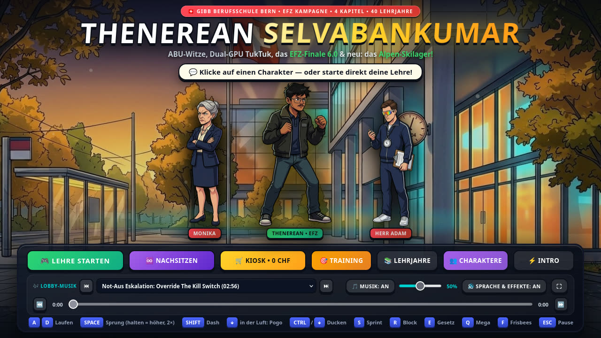
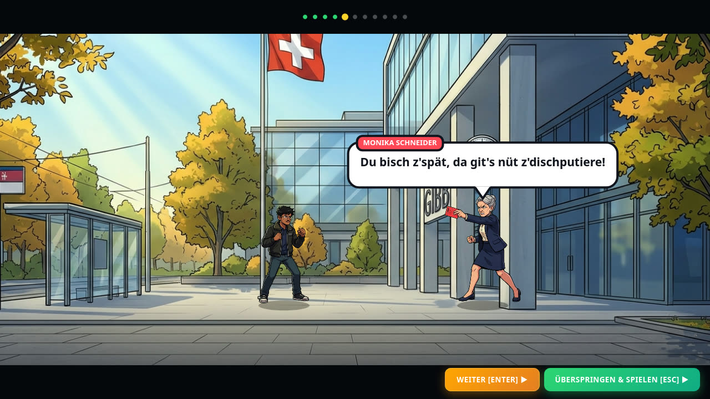
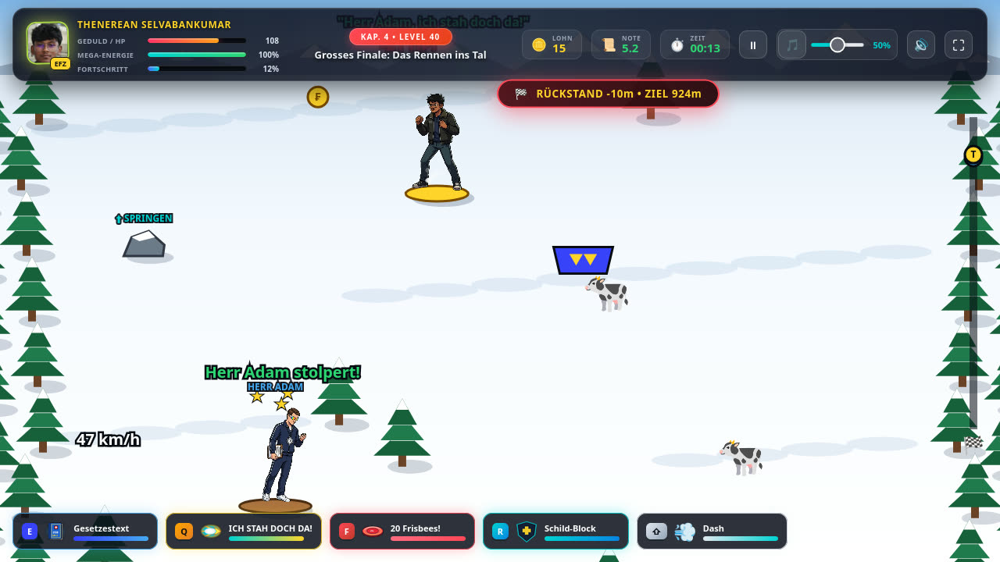

# 🎮 Thenerean Selvabankumar — Das GIBB Abenteuer

> *„HERR ADAM, ICH STAH DOCH DA!"*

Montagmorgen, 08:03 Uhr, Berufsschule GIBB Bern. **Thenerean Selvabankumar** ist genau 2.54 Sekunden zu spät — und zwischen ihm und seinem Informatik-EFZ mit Note 6.0 stehen Monika Schneider, Herr Adam mit 20 Frisbees, ein überhitztes Server-TukTuk und Tung Tung Tung Sahur.

Ein handgemachtes 2D-Action-Game voller Insider, Original-Sprüche und eigenem Soundtrack.



## Was dich erwartet

**40 Levels in 4 Kapiteln** — und kaum zwei spielen sich gleich:

- 🏃 **Parcours** mit Doppelsprung, Dash und Pogo über Lava-Gruben, die ihren Namen verdienen
- 🔥 **Der Boden ist Lava — von der Seite:** eine Lava-Wand (oder Lawine) rollt von links heran. Wer bremst, verliert
- ⚔️ **Bosskämpfe** mit Phasen, angekündigten Angriffen und Perfekt-Block
- 🧗 **Turm-Fluchten** vor der steigenden Flut, 🚀 **Raketenflüge** mit Melonen-Laser
- 🎿 **Skilager in den Alpen:** Abfahrt auf dem Frisbee, Slalom gegen die Stoppuhr, Nacht-Slalom mit Stirnlampe, Flucht vor der Lawine und das Rennen ins Tal gegen Herr Adam
- ❄️ **Schneeballschlacht** gegen die halbe Schule

| Animiertes Intro | Skilager |
| --- | --- |
|  |  |

Dazu kommt alles, was man zwischen zwei Lektionen so braucht:

- 🎯 **Training** — übe gegen die Puppe oder wähle einen echten Boss als Sparringspartner
- ♾️ **Nachsitzen** — Endlos-Arena, nach jeder Welle wählst du einen Bonus
- 🛒 **Kiosk** — gib deinen Lehrlingslohn für dauerhafte Upgrades aus
- 👥 **Charakter-Galerie** mit über 80 Original-Sprüchen
- 🎶 **Jukebox** in der Lobby mit eigenem Soundtrack zum Vor- und Zurückspulen
- 4 Schwierigkeitsgrade von *Leicht* bis *Extrem*

## Spielen

**Windows:** `Thenerean_Selvabankumar.exe` doppelklicken. Keine Installation, läuft auch vom USB-Stick. Der Spielstand landet als `thenerean_save.json` neben der EXE.

**Überall sonst (Browser):**

```bash
python start_game.py
```

Das Spiel öffnet sich unter `http://localhost:8080`. Unter Windows geht auch ein Doppelklick auf `START_SPIEL.bat`.

## Steuerung

| Taste | Zu Fuss | Auf der Piste |
| --- | --- | --- |
| `A` / `D` | Laufen | Lenken |
| `SPACE` | Springen (halten = höher, 2× = Doppelsprung) | Sprung über Steine und Frisbees |
| `SHIFT` | Dash | Ausweich-Dash |
| `CTRL` / `↓` | Ducken, in der Luft: Pogo | Hocke (schneller) |
| `S` | Sprint | Hocke (schneller) |
| `W` | — | Bremsen |
| `E` / Linksklick | Gesetzestext werfen | Gesetzestext werfen |
| `Q` | Mega-Schrei „ICH STAH DOCH DA!" | Piste freischreien |
| `F` | 20 Frisbees | Frisbee-Turbo |
| `R` | Schild-Block, im letzten Moment = Perfekt-Block | Schild-Block |
| `ESC` / `P` | Pause | Pause |
| `F11` | Vollbild | Vollbild |

Im Raketenflug steuerst du mit `W` / `S`. Auf Touch-Geräten erscheinen automatisch Buttons.

## Im Repo

| Ordner / Datei | Inhalt |
| --- | --- |
| `game/` | Das Spiel: HTML, CSS, JavaScript und alle Assets |
| `main_app.py`, `Thenerean_Selvabankumar.spec` | Desktop-Hülle und PyInstaller-Rezept für die EXE |
| `start_game.py` | Kleiner lokaler Webserver für den Browser-Start |
| `Quellmedien_und_Rohdaten/`, `Alle Videos/`, `Alle Musik/` | Rohmaterial, aus dem Sprites, Sprüche und Musik entstanden sind |
| `Entwickler_Archiv/` | Ältere Versionen |

---

Made by Techi & Bentiger.
